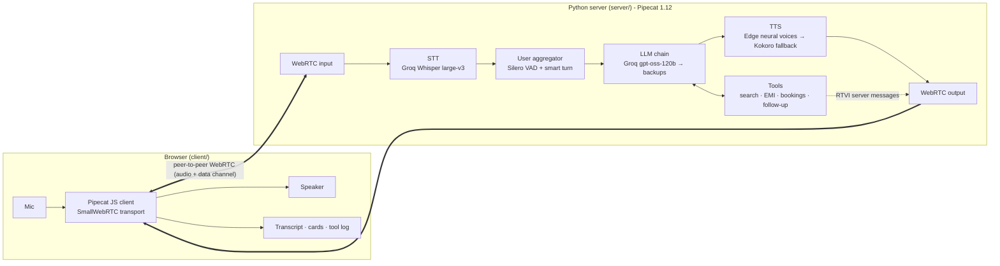

# Tatsat Real Estate: Talk to Aditi

A real-time Hindi + English AI voice agent for a fictional Ahmedabad real estate agency, built with [Pipecat](https://github.com/pipecat-ai/pipecat). Runs on a normal laptop (CPU only) on free tiers.

Aditi searches listings, answers questions, works out home-loan EMIs, books and manages site visits, and sends a WhatsApp follow-up. You can interrupt her mid-sentence or switch language mid-call ("Hindi mein baat karo"). The browser shows a live transcript, property and booking cards, a tool log and per-turn latency.

> All properties, prices and bookings are fictional. The areas are real Ahmedabad/Gandhinagar neighbourhoods.

## Features

- **Natural turn-taking.** Silero VAD plus Pipecat's smart-turn model detect when you've finished speaking; barge-in stops Aditi immediately.
- **Hindi and English.** Pick a language before the call or switch during it. Hindi is simple Hinglish in Devanagari; money is spoken the Indian way ("82 lakh", "1 crore 25 lakh").
- **Tools:** `search_properties`, `get_property_details`, `calculate_emi`, `schedule_site_visit`, `find_my_visits`, `reschedule_site_visit`, `cancel_site_visit`, `send_follow_up`, `set_language`, `end_call`.
- **Bookings in SQLite** (`data/tatsat.db`), so callers can ring back to check, move or cancel a visit.
- **WhatsApp follow-up** with the homes the caller liked plus 2–3 more good options ([details](#follow-up-messages)).
- **End-of-call summary:** duration, searches, homes discussed, EMI and visits.
- **Silence handling:** after 10 s of silence Aditi gives one warning, then ends the call.
- **Example question chips** in both languages.
- **Conversation tests:** scripted and LLM-simulated callers scored by a judge LLM ([evals/README.md](evals/README.md)).
- **Resilient on free tiers:**
  - LLM backup chain: Groq `gpt-oss-120b` → `qwen3.8-27b` → `gpt-oss-20b` → Gemini. On a rate limit, error or stall, the same turn silently re-runs on the next model.
  - Voice fallback: if the cloud voice fails, local Kokoro speaks the same sentence.
  - Fixed lines (greeting, "one moment", silence warning, goodbye) play from pre-generated audio.
- **Every stage is switchable in `.env`:** Groq / Sarvam STT; Groq / Gemini / Sarvam LLM; Edge / Gemini / Kokoro / Sarvam TTS.

## Architecture



Browser and server talk over SmallWebRTC (local peer-to-peer WebRTC, no Daily or LiveKit account). Transcripts and card data travel over the WebRTC data channel using Pipecat's RTVI protocol.

## Tech stack

| Stage | Default (free) | Alternatives |
|---|---|---|
| Framework | Pipecat `1.12.0` + Pipecat JS client `1.13.1` | |
| Transport | `SmallWebRTCTransport` | |
| Speech-to-text | Groq `whisper-large-v3` | `whisper-large-v3-turbo`, Sarvam `saaras:v3` |
| LLM | Groq `openai/gpt-oss-120b` → `qwen/qwen3.8-27b` → `openai/gpt-oss-20b` → Gemini `gemini-3.1-flash-lite` | Any order via `LLM_PROVIDER` + `LLM_FALLBACK_CHAIN`; Sarvam `sarvam-105b` |
| Text-to-speech | Edge neural voices via `edge-tts` (no key): `en-IN-NeerjaNeural`, `hi-IN-SwaraNeural` | Gemini TTS (10 free requests/day), Kokoro, Sarvam `bulbul:v3` |
| TTS fallback | Kokoro (local CPU) | `none` |
| Turn-taking | Silero VAD + smart-turn v3 (CPU) | |
| Server / UI | FastAPI + Uvicorn / vanilla HTML, CSS, JS | |

## Setup

Requires Python 3.12 (3.11–3.13 work), [uv](https://docs.astral.sh/uv/getting-started/installation/), a microphone, and Chrome, Edge or Firefox. Node.js is not needed; the JS SDK is bundled in `client/vendor/`.

1. Clone and install:

   ```bash
   git clone https://github.com/KaunteyAcharya/voice-ai-agent.git
   cd voice-ai-agent
   uv sync
   ```

   <details><summary>Without uv</summary>

   ```bash
   python -m venv .venv
   # Windows: .venv\Scripts\activate    macOS/Linux: source .venv/bin/activate
   pip install "pipecat-ai[google,groq,kokoro,sarvam,silero,webrtc]==1.12.0" fastapi==0.143.1 uvicorn==0.54.0 python-dotenv==1.2.1 edge-tts==7.3.1
   python server/main.py
   ```
   </details>

2. Get free API keys (no credit card):
   - Groq: <https://console.groq.com/keys>
   - Google AI Studio: <https://aistudio.google.com/apikey>
   - Optional, Sarvam: <https://dashboard.sarvam.ai> (new accounts get free credit)

3. Create `.env` and paste your keys into `GROQ_API_KEY` and `GOOGLE_API_KEY`:

   ```bash
   cp .env.example .env        # PowerShell: Copy-Item .env.example .env
   ```

## Run

Double-click `start.bat` (Windows), run `./start.sh` (macOS/Linux), or from the project folder:

```bash
uv run server/main.py
```

Open <http://localhost:7860>, pick English or हिंदी, click **Start call** and allow the microphone.

The first launch takes 10–20 s to load models and downloads the Kokoro fallback voice in the background (about 340 MB, once, to `~/.cache/pipecat/kokoro-onnx`).

## Demo script

Seeded bookings: Sapna Greens (SH-102) is taken tomorrow at 11 AM and 4 PM, and Saturday at 11 AM and 12 PM.

### English

1. "Hi, I want to buy a flat in Bopal."
2. "Three BHK, budget around 90 lakh." → **Sapna Greens, ₹82 L**
3. "Does it have parking?"
4. "What would my EMI be on a 70 lakh loan?" → **₹60,748 / month**
5. "I'd like to visit tomorrow at 11 AM. I'm Kaunteya, 98765 43210." → slot taken, she offers 12 PM or 10 AM
6. "12 works." → **Site visit confirmed**
7. Talk over her mid-sentence to test barge-in, or say "Can we continue in Hindi?"

### हिंदी

1. "मुझे सैटेलाइट में किराये पर फ़्लैट चाहिए।"
2. "दो BHK, तीस हज़ार तक।" → **मानसी अपार्टमेंट्स, ₹28,000/महीना**
3. "ठीक है, सपना ग्रीन्स देखना है, शनिवार सुबह 11 बजे।" → स्लॉट बुक है
4. "दोपहर 1 बजे ठीक है। नाम राहुल, नंबर 9876543210।" → **साइट विज़िट कन्फ़र्म**
5. Hinglish works too: "Mujhe Bopal mein 3 BHK chahiye, budget 90 lakh."

### Manage a booking

1. "Can you check my site visit? My number is 98765 43210."
2. "Move it to 5 PM." → **Visit rescheduled**
3. "Actually, cancel it." → **Visit cancelled**
4. "That's all, bye!" → Aditi hangs up and the call summary appears

## Follow-up messages

When the caller agrees, Aditi saves their number in the `leads` table and composes a message:

```
Hi Rohan, thanks for calling Tatsat Real Estate!

Homes you were interested in:
• Sapna Greens (SH-102) - 3 BHK apartment, Bopal - ₹82 L - Ready to move

A few more good options for you:
• Aangan Residency (SH-103) - 2 BHK apartment, Bopal - ₹58 L - Under construction
• Shaligram Heights (SH-101) - 3 BHK apartment, Satellite - ₹95 L - Ready to move
```

Delivery is set by `MESSAGE_CHANNEL`:

| Channel | Setup | Behaviour |
|---|---|---|
| `preview` (default) | None | Saved to the `messages` table and shown in the UI with an **Open in WhatsApp** link, pre-filled and ready to send. |
| `whatsapp` | Meta's free test number, up to 5 verified recipients | Sent automatically through the WhatsApp Cloud API. |

To use `whatsapp`:

1. Create an app at <https://developers.facebook.com/apps> and add the WhatsApp product.
2. Under **WhatsApp → API Setup**, add and verify your number as a recipient.
3. Put the access token and Phone number ID in `.env` as `WHATSAPP_TOKEN` and `WHATSAPP_PHONE_NUMBER_ID`, and set `MESSAGE_CHANNEL=whatsapp`.
4. Send any message from your phone to the test number. Free-form messages are only delivered inside WhatsApp's 24-hour window.

The temporary token expires after 24 hours.

## Configuration

All settings live in `.env`; restart the server after changing them.

| Want | Set |
|---|---|
| All-Sarvam stack (uses credit) | `STT_PROVIDER=sarvam`, `LLM_PROVIDER=sarvam`, `TTS_PROVIDER=sarvam`, `SARVAM_API_KEY` |
| Fully offline voice | `TTS_PROVIDER=kokoro` |
| Speech speed | `SPEECH_RATE=1.25` (0.5–2.0; not supported by Gemini TTS) |
| Different voice | `EDGE_VOICE_EN=en-IN-NeerjaExpressiveNeural`, `EDGE_VOICE_HI=hi-IN-MadhurNeural` |
| Silence timeout | `IDLE_TIMEOUT_SECS=10` |
| No voice fallback | `TTS_FALLBACK=none` |

## Free-tier usage (5-minute demo)

| Service | Usage | Free allowance |
|---|---|---|
| Groq Whisper | 25–40 requests | 20 req/min, 2,000 req/day |
| Groq LLMs | 1 request per turn plus 1 per tool call | About 8K tokens/min per model, hence the chain |
| Gemini Flash-Lite | Only when all Groq models are busy | Per-account limits |
| Edge TTS | 1 request per sentence | No key, no published limit |
| Kokoro | Local | Unlimited |

The default setup costs nothing. The Gemini free tier may use prompts to improve Google's products, so don't share real personal data on demo calls.

## Troubleshooting

- **Microphone blocked:** allow it from the address-bar lock icon and reload. Use `http://localhost:7860` exactly; browsers only allow the mic on localhost or HTTPS.
- **"Server setup needed" banner:** `.env` is missing or misnamed (not `.env.txt`), or the server wasn't restarted.
- **Port 7860 in use:** set `PORT=7861` in `.env`.
- **`switching to ...` in the logs:** a model was rate-limited or busy and the turn moved to the next one. Expected.
- **Voice suddenly sounds robotic:** Edge TTS was unreachable and Kokoro took over. `edge-tts` uses an unofficial endpoint; if it stops working, set `TTS_PROVIDER=kokoro`.
- **Kokoro download failed:** delete `~/.cache/pipecat/kokoro-onnx` and restart.
- **Connects but silent on a corporate network:** some VPNs block UDP. Try without the VPN.

## Project structure

```
server/
  main.py         FastAPI app, WebRTC signalling (/api/offer)
  bot.py          Pipecat pipeline, language switching, silence handling
  llm_chain.py    LLM backup chain and failover strategy
  voices.py       Edge / Gemini TTS with audio cache and Kokoro fallback
  tools.py        Search, EMI and booking logic plus Pipecat tool functions
  bookings.py     SQLite store: visits, leads, message outbox
  followup.py     Follow-up message builder and delivery
  prompts.py      Persona and per-language rules
  listings.py     12 fictional listings (English + Hindi)
  parsing.py      Amounts, relative dates and phone numbers
  config.py       .env loading and validation
  model_files.py  Safe Kokoro model download
client/           Single-page UI and bundled Pipecat JS SDK
tests/            pytest suite
evals/            Pipecat eval scenarios
data/             tatsat.db (created on first run, not committed)
```

## Development

```bash
uv run --group dev pytest
```

Conversation tests (two terminals; see [evals/README.md](evals/README.md)):

```bash
uv sync --group evals
uv run evals/eval_bot.py -t eval --port 7870
uv run python -m pipecat.evals run evals/scenarios --bot-url ws://localhost:7870 --trigger-disconnect
```

Open `http://localhost:7860/?debug` for `window.aditiDebug`, which lets you type to Aditi with `aditiDebug.say("...")` during a call.

## Limitations

- Gujarati was dropped because there's no free, good-quality Gujarati TTS that runs on CPU. The Sarvam stack supports it.
- Groq Whisper is not streaming, which adds about 0.3–0.5 s per turn. Sarvam STT streams.
- No free SMS API reaches arbitrary Indian numbers, so follow-ups use WhatsApp.

## License

[MIT](LICENSE)
