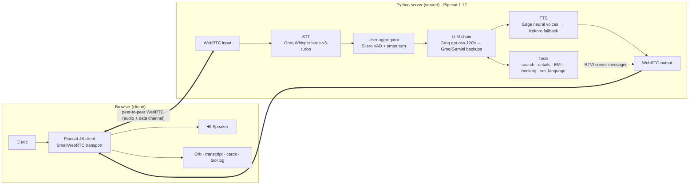

# Tatsat Real Estate · Talk to Aditi 🏠🎙️

A real-time, **Hindi + English** AI voice agent for a fictional Ahmedabad real estate agency. Built with [Pipecat](https://github.com/pipecat-ai/pipecat).
It runs on a normal laptop (**CPU only, no GPU**) and on **free tiers** (₹0 with the default setup).

Aditi greets you, asks what you're looking for one question at a time, searches listings, works out a home-loan EMI and books site visits. You can **interrupt her mid-sentence** or **switch language mid-call** ("Hindi mein baat karo").
Everything shows up live in the browser: transcript, property cards, EMI card, booking confirmation and a tool-call log.

> All properties, prices and bookings are fictional. The areas are real Ahmedabad/Gandhinagar neighbourhoods.

---

## Features

- 🗣️ **Natural voice conversation.** Silero VAD plus Pipecat's smart-turn model decide when you've finished speaking, and barge-in stops Aditi immediately.
- 🇮🇳 **Hindi and English.** Pick a language before the call, or ask Aditi to switch during it. Hindi replies are written in Devanagari so the voice pronounces them correctly. Money is spoken the Indian way ("82 lakh", "1 crore 25 lakh").
- 🔧 **Function calling:** `search_properties`, `get_property_details`, `calculate_emi`, `schedule_site_visit`, `find_my_visits`, `reschedule_site_visit`, `cancel_site_visit`, `send_follow_up`, `set_language`, `end_call`.
- 🗂️ **Bookings in SQLite:** site visits are saved to `data/tatsat.db` (Python's built-in `sqlite3`, nothing to install), so callers can ring back to check, move or cancel a visit, and bookings survive a restart.
- 📲 **WhatsApp follow-up:** once Aditi has recommended homes she asks for the caller's number, saves them as a lead, and sends a WhatsApp message with the homes they liked, 2–3 more good options and any booked visit (see [Follow-up messages](#follow-up-messages)).
- 🧾 **End-of-call summary:** when the call ends (Aditi hangs up after "bye", or you click End call), a card shows the duration, what was searched, the homes discussed, any EMI and the visits booked, moved or cancelled.
- 💬 **Example questions:** clickable chips under the conversation in both languages. Clicking one before a call starts the call and asks it after the greeting; during a call it asks straight away.
- 🧪 **Conversation tests:** Pipecat's eval harness runs scripted conversations and LLM-simulated callers against Aditi, with a judge LLM scoring the results (see [evals/README.md](evals/README.md)).
- 🏘️ **12 fictional listings** across Satellite, Bopal, Prahlad Nagar, SG Highway, Thaltej, Chandkheda and Gandhinagar Sector 21. If nothing matches, Aditi offers the closest alternatives.
- 📅 **Relative dates and times:** "kal", "parso", "Saturday", "शनिवार", "शाम 5 बजे".
- ⏰ **Pre-booked slots**, so the demo shows the "that slot is taken, how about 12 PM?" path.
- 🎨 **Polished UI:** an animated orb that reacts differently to you and to Aditi, a status label, a live transcript with spoken-word highlighting, property, EMI and booking cards, a tool log and a latency badge.
- 🛟 **Doesn't fall over on free tiers:**
  - **LLM backup chain:** Groq `gpt-oss-120b` first (about 1.2 s for a full search-and-answer turn), then Groq `qwen3.8-27b` and `gpt-oss-20b`, then Gemini. Each Groq model has its own free 8K-tokens-per-minute limit; when one is used up (429), returns an error, or stalls, the same turn silently re-runs on the next, so the caller is never asked to repeat themselves.
  - **Voice fallback:** if the cloud voice fails, the same sentence is spoken by local Kokoro TTS, so nothing is skipped.
  - **No dead air:** fixed lines (greeting, "one moment" while tools run, "are you still there?", the apology) play from pre-generated audio, with no LLM call and no free requests used.
- 🔀 **Every stage is switchable in `.env`:** Groq / Sarvam STT, Gemini / Groq / Sarvam LLM, Edge / Gemini / Kokoro / Sarvam TTS.

## Architecture



The browser and server talk over **SmallWebRTC**, which is local peer-to-peer WebRTC with no Daily or LiveKit account. Transcripts, speaking events and the custom card messages travel over the WebRTC data channel using Pipecat's RTVI protocol.

## Tech stack

| Stage | Default (free) | Alternatives (set in `.env`) |
|---|---|---|
| Framework | Pipecat `1.12.0` (Python) + Pipecat JS client `1.13.1` | |
| Transport | `SmallWebRTCTransport` (local WebRTC) | |
| Speech-to-text | Groq Whisper `whisper-large-v3` (free) | `whisper-large-v3-turbo` (a little faster), Sarvam `saaras:v3` (uses credit) |
| LLM | Groq `openai/gpt-oss-120b`, backed by Groq `qwen/qwen3.8-27b` → `openai/gpt-oss-20b` → Google `gemini-3.1-flash-lite` | Any order via `LLM_PROVIDER` + `LLM_FALLBACK_CHAIN`; Sarvam `sarvam-105b` |
| Text-to-speech | Microsoft Edge neural voices via `edge-tts` (free, no key): `en-IN-NeerjaNeural`, `hi-IN-SwaraNeural` | Gemini TTS (only 10 free requests/day), Kokoro (local CPU), Sarvam `bulbul:v3` |
| TTS fallback | Kokoro (local CPU, unlimited) | `none` |
| VAD / turn-taking | Silero VAD + Pipecat smart-turn v3 (both CPU) | |
| Server | FastAPI + Uvicorn | |
| UI | Vanilla HTML/CSS/JS, Noto Sans Devanagari, Plus Jakarta Sans | |

## Setup from scratch

**You need:** Python **3.12** (3.11–3.13 work), [uv](https://docs.astral.sh/uv/getting-started/installation/), a microphone, and Chrome, Edge or Firefox. You don't need Node.js; the JS SDK is already bundled in `client/vendor/`.

1. **Get the code and install dependencies** (uv creates `.venv` and installs the pinned versions from `uv.lock`):

   ```bash
   git clone https://github.com/KaunteyAcharya/voice-ai-agent.git
   cd voice-ai-agent
   uv sync
   ```

   <details><summary>Without uv (plain pip)</summary>

   ```bash
   python -m venv .venv
   # Windows: .venv\Scripts\activate    macOS/Linux: source .venv/bin/activate
   pip install "pipecat-ai[google,groq,kokoro,sarvam,silero,webrtc]==1.12.0" fastapi==0.143.1 uvicorn==0.54.0 python-dotenv==1.2.1 edge-tts==7.3.1
   python server/main.py
   ```
   </details>

2. **Get free API keys.** No credit card is needed for these two:
   - **Groq**: sign in at <https://console.groq.com/keys> → *Create API Key*.
   - **Google AI Studio (Gemini)**: <https://aistudio.google.com/apikey> → *Create API key*.
   - *(Optional)* **Sarvam**: <https://dashboard.sarvam.ai> → sign up (new accounts get free credit) → *API Keys*.

3. **Create your `.env`:**

   ```bash
   cp .env.example .env        # Windows PowerShell: Copy-Item .env.example .env
   ```

   Then paste your keys into `GROQ_API_KEY` and `GOOGLE_API_KEY`.

## Run

**Windows:** double-click `start.bat` in the project folder.
**macOS / Linux:** run `./start.sh`.

Or, from a terminal **inside the project folder**:

```bash
uv run server/main.py
```

```
  🏠  Tatsat Real Estate · Talk to Aditi
  ➜  Open http://localhost:7860 in Chrome, Edge or Firefox
     STT=groq  LLM=groq (+3 backups)  TTS=edge (fallback: kokoro)
```

Open the URL, pick **English** or **हिंदी**, click **Start call**, allow the microphone, and Aditi greets you.

**First run:** the server downloads the Kokoro fallback voice model in the background (about 340 MB, one time, saved to `~/.cache/pipecat/kokoro-onnx`). The first launch also takes 10–20 seconds while Pipecat loads its models.

## Demo script

Each script exercises search, a no-exact-match case, EMI, the slot-taken path and a confirmed booking. Seeded bookings: **Sapna Greens (SH-102)** is already booked **tomorrow at 11 AM and 4 PM** and **Saturday at 11 AM and 12 PM**.

### English

1. *(Aditi greets you.)*
2. "Hi, I want to buy a flat in Bopal."
3. "Three BHK, budget around 90 lakh." → card: **Sapna Greens, ₹82 L**
4. "Does it have parking?" → `get_property_details`
5. "What would my EMI be if I take a 70 lakh loan?" → EMI card **₹60,748 / month**
6. "Okay, I'd like to visit tomorrow at 11 AM." → Aditi asks for your name and phone number.
7. "My name is Kaunteya, number 98765 43210." → **slot taken**; she offers 12 PM or 10 AM.
8. "12 works." → **Site visit confirmed, SH-xxxx**
9. **Interrupt test:** ask "Tell me about Prahlad Nagar options" and talk over her mid-sentence: "Actually, only rentals."
10. **Language switch:** "Can we continue in Hindi?" → she switches and answers in Hindi.

### हिंदी

1. *(अदिति नमस्ते करती है)*
2. "मुझे सैटेलाइट में किराये पर फ़्लैट चाहिए।"
3. "दो BHK, तीस हज़ार तक।" → **मानसी अपार्टमेंट्स, ₹28,000/mo**
4. "और थलतेज में चार BHK बंगला कितने का है?" → **बनियन बंगलोज़, 3 करोड़ 50 लाख**
5. "अगर मैं दो करोड़ का लोन लूँ, बीस साल के लिए, तो EMI कितनी होगी?"
6. "ठीक है, सपना ग्रीन्स देखना है, शनिवार सुबह 11 बजे।" → **स्लॉट बुक है**, she offers alternatives.
7. "दोपहर 1 बजे ठीक है। नाम राहुल, नंबर 9876543210।" → **साइट विज़िट कन्फ़र्म**
8. **Hinglish works too:** "Mujhe Bopal mein 3 BHK chahiye, budget 90 lakh."
9. **Switch back:** "English mein baat karo."

### Manage a booking

1. "I booked a site visit earlier, can you check it? My number is 98765 43210." → card: **Your visits**
2. "Please move it to 5 PM." → **Visit rescheduled**, same code
3. "Actually, cancel it. Yes, I'm sure." → **Visit cancelled**
4. "That's all, thanks, bye!" → Aditi says goodbye, hangs up, and the **call summary** appears

### Off-topic check

"Who won yesterday's cricket match?" → Aditi politely says she only helps with Tatsat Real Estate properties and steers back.

## Follow-up messages

When a caller agrees, Aditi saves their number in the `leads` table (with the homes they were interested in) and writes a message like this:

```
Hi Rohan, thanks for calling Tatsat Real Estate! 🏠

Homes you were interested in:
• Sapna Greens (SH-102) - 3 BHK apartment, Bopal - ₹82 L - Ready to move

A few more good options for you:
• Aangan Residency (SH-103) - 2 BHK apartment, Bopal - ₹58 L - Under construction, possession December 2027
• Shaligram Heights (SH-101) - 3 BHK apartment, Satellite - ₹95 L - Ready to move
...
Reply here or call us anytime to book a visit. - Aditi, Tatsat Real Estate
```

How it's delivered depends on `MESSAGE_CHANNEL` in `.env`:

| Channel | Cost and setup | What happens |
|---|---|---|
| `preview` (default) | Free, no setup | Saved in the `messages` table and shown in the UI with an **Open in WhatsApp** button that opens WhatsApp with the message pre-filled to the caller's number, ready to send in one tap. |
| `whatsapp` | Free with Meta's **test number**, up to 5 recipient numbers you verify | Sent automatically through the WhatsApp Cloud API. |

To use `whatsapp`:

1. Create an app at <https://developers.facebook.com/apps> and add the **WhatsApp** product.
2. On **WhatsApp → API Setup**, add your own number as a recipient and verify it. The test number can message up to 5 verified numbers.
3. Copy the **temporary access token** and the **Phone number ID** into `.env` as `WHATSAPP_TOKEN` and `WHATSAPP_PHONE_NUMBER_ID`, and set `MESSAGE_CHANNEL=whatsapp`.
4. From your phone, send any message (for example "hi") to the test number.

WhatsApp only delivers free-form text inside its 24-hour customer-service window, which is why step 4 is needed; outside it, Meta requires a pre-approved message template and the UI shows "WhatsApp didn't deliver it" with the reason. The temporary token expires after 24 hours (generate a new one, or create a permanent System User token). There's no free SMS API that reaches any Indian number, so SMS isn't included.

## Switching providers

Everything is controlled from `.env`, and you need to restart the server after changing it.

| Want | Set |
|---|---|
| All-Sarvam, best Indic voice (uses credit) | `STT_PROVIDER=sarvam`, `LLM_PROVIDER=sarvam`, `TTS_PROVIDER=sarvam`, plus `SARVAM_API_KEY` |
| Fully offline voice (unlimited) | `TTS_PROVIDER=kokoro` |
| Groq for the LLM | `LLM_PROVIDER=groq`. The free plan allows about 8K tokens/min, so a fast demo can hit 429s. |
| No automatic voice fallback | `TTS_FALLBACK=none` |
| Faster or slower speech | `SPEECH_RATE=1.25` (1.0 = normal, range 0.5–2.0; Edge, Kokoro and Sarvam. Gemini TTS has no speed setting) |
| A different voice | `EDGE_VOICE_EN=en-IN-NeerjaExpressiveNeural` or `EDGE_VOICE_HI=hi-IN-MadhurNeural` (male) |
| Gemini's voice instead (10 free requests/day) | `TTS_PROVIDER=gemini` |

## How the free tiers are used (rough numbers for a 5-minute demo)

| Service | Used per 5-min demo | Free allowance |
|---|---|---|
| Groq Whisper | 1 request per thing you say, about 25–40 requests and 3–4 audio-minutes | 20 req/min, 2,000 req/day, 2 audio-hours/hour |
| Gemini Flash-Lite | 1 request per turn plus 1 per tool call, about 40–70 requests | Free tier, limits per account (AI Studio → *Rate limits*). It also returns 503 "high demand" at busy times. **Either way, Groq takes over automatically.** |
| Groq LLMs (backups) | Only used when Gemini fails | About 8K tokens/min each, which is why there are three of them |
| Edge TTS | 1 request per spoken sentence | No key and no published limit |
| Gemini TTS (optional) | 1 request per spoken sentence | **10 requests per day**, which is why it isn't the default |
| Kokoro | Runs locally | Unlimited |

With the default setup a typical demo costs **₹0**. With the all-Sarvam setup, a 5-minute demo uses roughly **₹8–12** of Sarvam credit (TTS is the largest part, at about ₹3 per 1,000 characters at the time of writing). Check <https://www.sarvam.ai/api-pricing> for current rates.

The Gemini free tier may use your prompts to improve Google's products. Don't say real personal data on a demo call.

## Troubleshooting

- **Aditi can't hear me / "Microphone blocked".** Click the lock icon in the address bar → *Microphone* → *Allow*, then reload. Use `http://localhost:7860` exactly, because browsers only allow mic access on `localhost` or HTTPS. On macOS also check *System Settings → Privacy & Security → Microphone* for your browser. On Windows check *Settings → Privacy & security → Microphone*.
- **No sound from Aditi.** Check the tab isn't muted and your output device is right. Clicking anywhere on the page helps if autoplay was blocked.
- **"Server setup needed" banner.** The server didn't find your keys. Make sure the file is named `.env` (not `.env.txt`), sits next to `pyproject.toml`, and that you restarted the server.
- **Port 7860 already in use.** Set `PORT=7861` in `.env`, or stop the other process. To find it, run `netstat -ano | findstr 7860` on Windows or `lsof -i :7860` on macOS/Linux.
- **`switching to GroqLLMService` in the logs.** Gemini was busy (503) or over quota (429), and the turn was re-run on a backup model. That's expected; nothing to fix. Aditi only apologises if every model in the chain fails.
- **Sarvam credit ran out.** Calls to Sarvam fail with 402/403 errors. Switch back to the free defaults or top up at dashboard.sarvam.ai.
- **The voice suddenly sounds robotic.** That's the Kokoro fallback: Edge TTS couldn't be reached. The next call tries Edge again. `edge-tts` uses an unofficial Microsoft endpoint, so if it stops working for good, set `TTS_PROVIDER=kokoro` or `gemini`.
- **Kokoro download failed.** Delete `~/.cache/pipecat/kokoro-onnx` and restart; partial downloads are detected and retried.
- **The call connects but nothing happens on a corporate network.** WebRTC on localhost needs no TURN server, but some VPNs block UDP. Try with the VPN off.
- **It's slow on first use.** The first call loads the VAD and smart-turn models. Expect 1–2.5 s response latency on free tiers; the latency badge shows the time from the end of your speech to the start of Aditi's voice.

## Project structure

```
server/
  main.py         FastAPI app: serves client/, WebRTC signalling (/api/offer), prints the URL
  bot.py          Pipecat pipeline, provider factories, language switching, error handling, TTS failover
  tools.py        PropertyDesk (search / details / EMI / booking logic) + Pipecat tool functions
  listings.py     12 fictional listings with English + Hindi text
  parsing.py      "90 lakh", "kal", "शाम 5 बजे", phone numbers → structured values
  prompts.py      Aditi's persona and per-language rules
  config.py       .env loading and validation
  llm_chain.py    LLM backup chain and the failover strategy
  voices.py       Edge / Gemini TTS with audio cache and a no-gap Kokoro fallback
  bookings.py     SQLite store: site visits, follow-up leads and the message outbox
  followup.py     follow-up message builder and WhatsApp / preview delivery
  model_files.py  safe one-time Kokoro model download
client/
  index.html, styles.css, app.js   the single-page UI
  vendor/pipecat-client.js         bundled Pipecat JS SDK (rebuild with client/build)
tests/            pytest suite for parsing, tools and bookings (run: uv run --group dev pytest)
evals/            Pipecat eval scenarios: scripted turns and simulated callers (see evals/README.md)
data/             tatsat.db, the bookings database (created on first run, not committed)
```

## Development

```bash
uv run --group dev pytest                      # 99 unit tests, no network needed
cd client/build && npm install && npm run build   # only when upgrading the JS SDK
```

Conversation tests (two terminals; details in [evals/README.md](evals/README.md)):

```bash
uv sync --group evals
uv run evals/eval_bot.py -t eval --port 7870
uv run python -m pipecat.evals run evals/scenarios --bot-url ws://localhost:7870 --trigger-disconnect
```

Open `http://localhost:7860/?debug` to get `window.aditiDebug`. It lets you feed fake events into the UI, or, during a call, type to Aditi with `aditiDebug.say("...")` instead of speaking.

## Notes and limitations

- **Gujarati was dropped** to keep the stack 100% free: there was no free, good-quality Gujarati TTS that runs on a CPU. The original Sarvam stack supports Gujarati if you want to add it back (`gu-IN`, Sarvam STT + Bulbul TTS).
- Live language switching updates the STT language and Whisper prompt, the TTS language (including the fallback voice), and the LLM system prompt in place, without reconnecting the call.
- Groq Whisper transcribes each utterance after you stop speaking (it isn't streaming), which adds about 0.3–0.5 s. Sarvam STT streams if you need lower latency.
- Bookings are stored in `data/tatsat.db`. Delete that file to start fresh; the demo's pre-booked slots are recreated on every start.

## License

[MIT](LICENSE)
